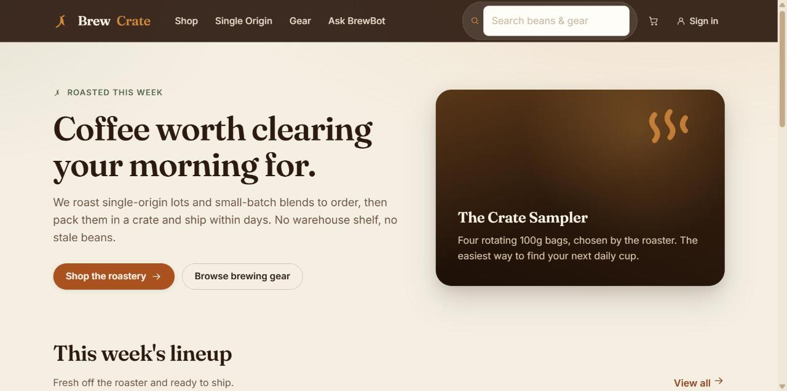
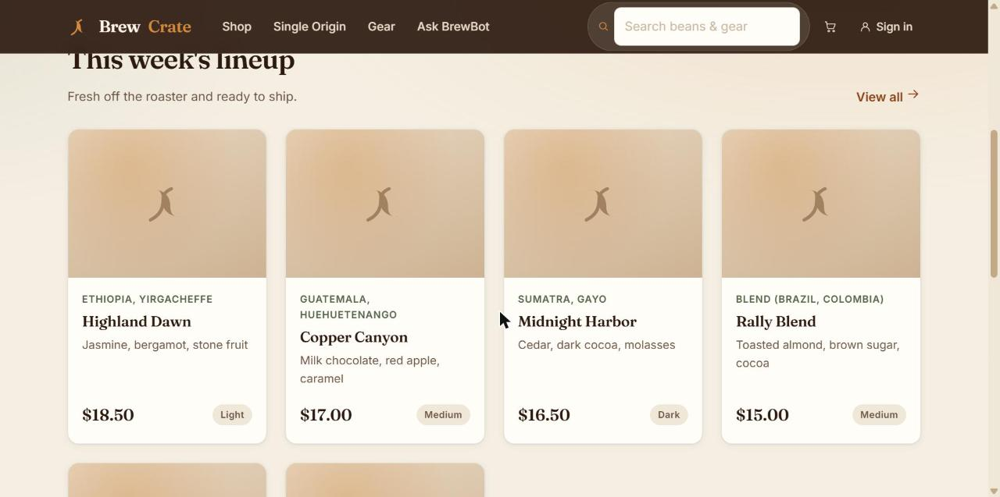
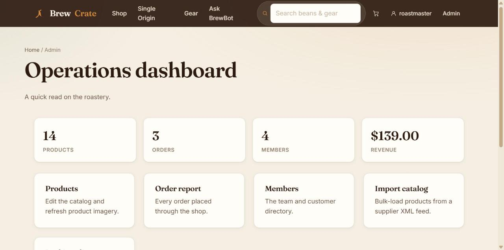

# BrewCrate

> A small-batch coffee roastery storefront — and a hands-on web security sandbox hiding inside it.


BrewCrate is a fully working e-commerce application for a fictional coffee
roastery. You can browse single-origin lots and brewing gear, add them to a
crate, check out, leave reviews, and manage the shop from an admin dashboard.

It is also a deliberately insecure **training target**. Under the hood it
contains a curated set of realistic security flaws spanning the OWASP Top 10 and
the OWASP API Security Top 10, so students, CTF players, and penetration testers
can practice finding and exploiting vulnerabilities against a codebase that
behaves like a real app rather than a checklist of toy bugs.

<p align="center">
  
  
</p>
<p align="center">
  
</p>

---

## Features

- **Storefront** — home page, full catalog, category browsing, and product
  detail pages with customer reviews.
- **Search** — search by name, origin, and tasting notes with category filters
  and sorting.
- **Cart & checkout** — cookie-backed cart, order placement, and downloadable
  receipts.
- **Accounts** — registration, login/logout, editable public profiles, and
  per-user order history.
- **Admin panel** — operations dashboard, product management, bulk catalog
  import, packing-slip templates, and an order/member directory.
- **Shop assistant** — an optional "BrewBot" helper (works offline, or with an
  LLM API key).
- **JSON & GraphQL endpoints** — a companion API surface for the catalog and
  accounts.

## Tech stack

| Layer      | Choice                              |
| ---------- | ----------------------------------- |
| Runtime    | Node.js (>= 18)                     |
| Web server | Express                             |
| Views      | EJS server-rendered templates       |
| Database   | SQLite via `better-sqlite3`         |
| Auth       | JSON Web Tokens in an HTTP-only cookie |
| Styling    | Hand-written CSS (no framework)     |
| API        | REST (JSON) + GraphQL               |

## Why this project

Reading about vulnerabilities is not the same as finding them. Most training
apps either feel like disconnected puzzle boxes or flag their own bugs so
plainly that the exercise becomes trivial. BrewCrate takes a different approach:

- The flaws live in **ordinary-looking code**, spread naturally across different
  routes and files the way accidental bugs appear in real projects.
- Nothing in the running app or the source comments points at where the issues
  are — you have to read, probe, and reason like you would against a real target.
- The weaknesses are **chainable**, rewarding the kind of multi-step thinking a
  real engagement demands.

It is a practical range for learning **web and API security end to end**:
reconnaissance, authentication and session analysis, access-control testing,
injection, server-side request and template abuse, and business-logic attacks.

> This repository intentionally ships with security weaknesses. That is the
> point. Do not reuse any of this code in a real product.

## Getting started

### Run locally

```bash
# 1. Install dependencies
npm install

# 2. Build the SQLite database with demo data
npm run seed

# 3. Start the server
npm start
```

Then open **http://127.0.0.1:3000**.

The demo database is created automatically on first start, so step 2 is
optional. Run `npm run seed` any time you want to reset it to a clean state.

By default the server binds to `127.0.0.1` only. You can override the host/port
with the `HOST` and `PORT` environment variables. If port 3000 is already in
use, pick another one:

```bash
PORT=3001 npm start            # macOS / Linux / Git Bash
```

```powershell
$env:PORT = 3001; npm start    # Windows PowerShell
```

### Run with Docker

```bash
# Build the image
docker build -t brewcrate .

# Run it, bound to localhost only
docker run --rm -p 127.0.0.1:3000:3000 brewcrate
```

### Optional: enable the AI assistant

BrewBot works out of the box in offline mode. To enable live answers, set an
OpenAI-compatible API key before starting the server:

```bash
export OPENAI_API_KEY=sk-...   # macOS / Linux / Git Bash
npm start
```

```powershell
$env:OPENAI_API_KEY = "sk-..."   # Windows PowerShell
npm start
```

If no key is set, the assistant simply falls back to canned responses — the app
never crashes because of a missing key.

## Demo accounts

| Role     | Username      | Password        |
| -------- | ------------- | --------------- |
| Admin    | `roastmaster` | `DarkRoast2026!`|
| Customer | `nora`        | `frenchpress`   |
| Customer | `dmitri`      | `espresso123`   |
| Customer | `lena`        | `coldbrewfan`   |

You can also register your own account from the sign-up page.

## Stuck, or grading someone else's work?

The exploit steps and fixes for every embedded flaw live in
[`SOLUTIONS.md`](SOLUTIONS.md) — it's the answer key for instructors and for
when you're genuinely stuck, not a spoiler to read first. Try finding the bugs
on your own before opening it.

## Security notice

**BrewCrate is intentionally vulnerable.** Please treat it accordingly:

- Run it **only** on `localhost` or inside an **isolated container / lab VM**.
- **Never** expose it to the public internet or an untrusted network.
- **Never** load it with real personal data, real credentials, or real payment
  details. Everything here is disposable test data.
- Use it only against systems and accounts you own or are explicitly authorized
  to test.

## License

Released under the [MIT License](LICENSE).
